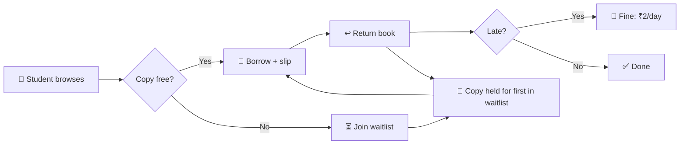

<div align="center">

# 📚 CampusShelf

### A smart Library Management System for your campus

*Two roles · Late fines · Waitlist · Printable issue slips*


### 🌐 [**View Live Demo**](https://YOUR-USERNAME.github.io/Library-management-system/)

</div>

---

## ✨ Why CampusShelf?

Most library demos only show a book list. CampusShelf runs the **whole borrowing cycle** — browse, borrow, wait, return, pay fines — with separate screens for the **Librarian** and the **Student**.

| 🔐 Two Roles | 💸 Auto Fines | ⏳ Smart Waitlist | 🧾 Issue Slips |
|:---:|:---:|:---:|:---:|
| Librarian & Student dashboards | ₹2 per late day, calculated on return | Returned copy is held for the first in queue | Printable slip with QR-style code |

---

## 🔄 How it works



---

## 🎯 Features

### 👩‍💼 Librarian
- 📊 **Dashboard** — live stats, copies by department, most borrowed books, recent activity
- 📚 **Book management** — add, edit, delete, search, filter by department & semester
- 🔁 **Issue / Return** — 14-day loan period with overdue highlighting
- ⏳ **Waitlist** control and 💸 **Fines** page with *Mark paid*
- 👥 **Members** overview and ⬇️ **CSV export** of all records

### 🎓 Student
- 📝 Register and log in with a personal account
- 🔎 Browse colourful **cover cards** by department and semester
- 📖 Borrow a book, or **join the waitlist** when copies run out
- 🕒 **My books** with days left, reading history and **My fines**
- 🖨️ Print an **issue slip** for every borrowed book

### 🧠 Smart rules
- Max **3 books** per student at a time
- Waitlisted copy is **held** — nobody else can take it
- Cannot delete a book that is still issued
- 🌙 Dark / ☀️ Light theme · 📱 fully responsive

---

## 🔑 Try it — demo accounts

| Role | Username | Password |
|:---:|:---:|:---:|
| 👩‍💼 Librarian | `librarian` | `lib123` |
| 🎓 Student | `student` | `stud123` |

> 💡 The demo already has an **overdue book** (to see fines) and a **waitlist entry**. Use *Reset demo data* in the librarian sidebar to restore it anytime.

---

## 🗂️ Project structure

```
Library-management-system/
├── 📄 index.html    →  page shell
├── 🎨 style.css     →  themes, layout, print styles
└── ⚙️ script.js     →  data, rules, pages, events
```

## 🚀 Run it

**Locally** — download the files into one folder and open `index.html`.

**On GitHub Pages** — *Settings → Pages → Deploy from a branch → `main` → `/ (root)` → Save.*

---

## 🧮 Under the hood

| Area | Logic |
|---|---|
| 💾 Storage | One JSON object (`books`, `members`, `issues`, `waitlist`) in `localStorage` |
| 📦 Availability | `copies − active issues − copies held for waitlist` |
| 💸 Fine | `max(0, return date − due date) × ₹2` |
| ⏳ Waitlist | Ordered by join date; on return the first entry becomes *ready* and holds a copy |

## ⚠️ Limitations
- Data is stored **per browser** — not shared across devices
- Passwords are stored as plain text in `localStorage` (fine for a demo, not for real use)
- The slip code is a visual QR-style pattern, not a scannable QR

## 🔮 Future ideas
- Backend + database (Node.js / Firebase) 🔐 hashed passwords
- 📧 Due-date email reminders · 📷 scannable QR / barcode slips

---

<div align="center">

**Made with ❤️ by Avik Dey**
CSE (AIML) · IEM Kolkata · IT Workshop (PCCCS382)

</div>
